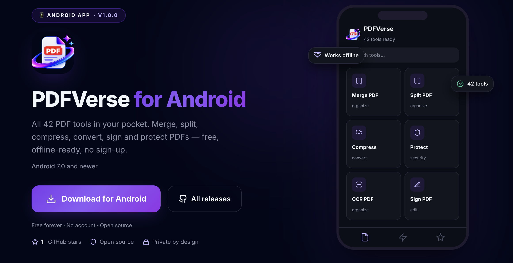
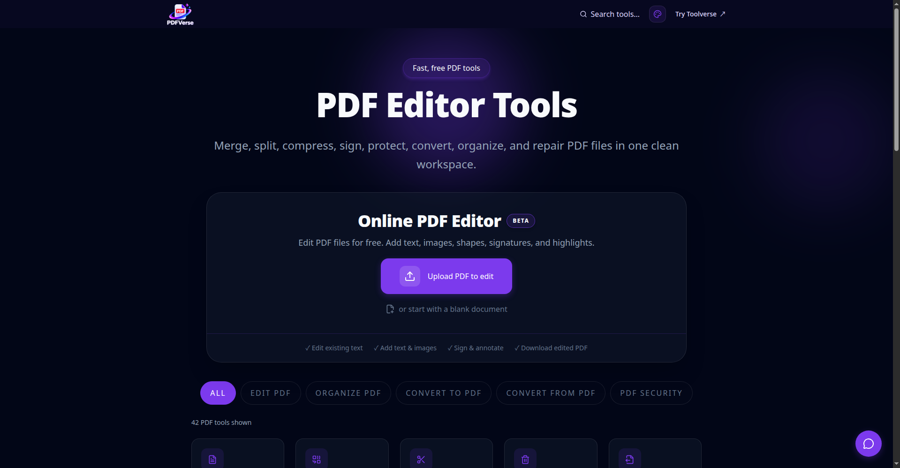
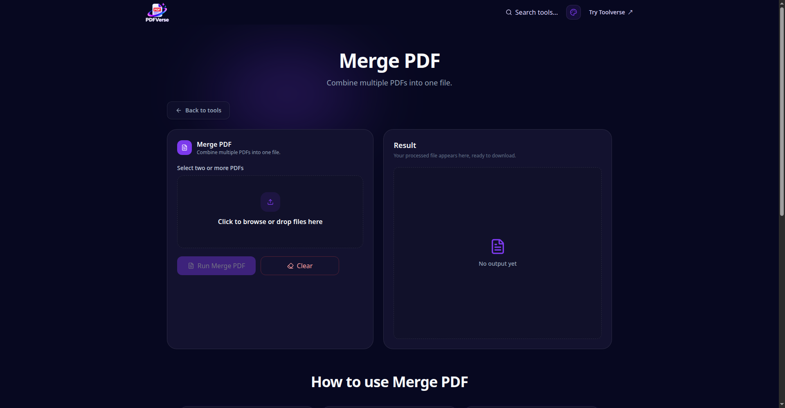
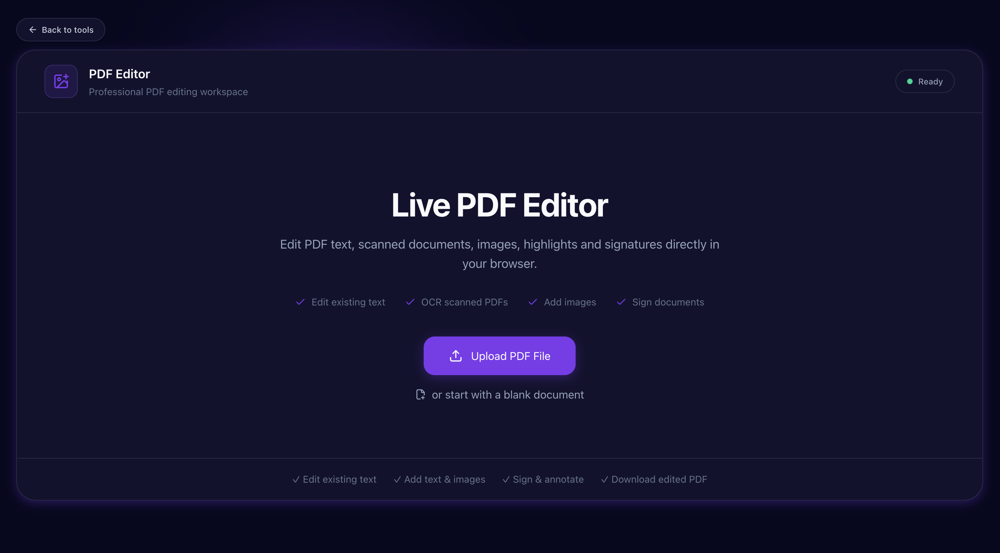

# PDFVerse

[](https://github.com/Surya-1301/PDFVerse/releases)
[](https://pdfverse.pages.dev)
[](LICENSE)

**Free online PDF tools — edit, organize, convert, compress, protect, and repair PDFs right in your browser.**

No sign-up. No watermarks on output. Most tools run entirely on your device, so your documents never leave your computer.

🌐 Live site:- https://pdfverse.pages.dev
---

## Android app


PDFVerse is also available as a native Android app — all 42 tools.

📥 **Download:** https://downloadpdfverse.dpdns.org

- Free forever, no account needed
- Most tools work fully offline on your device
- New releases are published on the [GitHub releases page](https://github.com/Surya-1301/PDFVerse/releases) — the download page always points to the latest APK

> The APK is debug-signed, so Android will show an "unknown developer" warning during sideloading. This is expected for apps installed outside the Play Store.

---

## Features

42 tools across 6 categories. Every tool has its own page with step-by-step guidance and FAQs.

### Organize PDF

| Tool | What it does |
|---|---|
| Merge PDF | Combine multiple PDFs into one file |
| Split PDF | Split by page ranges or every N pages |
| Remove pages | Delete selected pages |
| Extract pages | Pull selected pages into a new PDF |
| Organize PDF | Reorder pages via drag & drop |
| Add Pages to PDF | Insert pages from another PDF at any position |
| Compare PDF | Page-by-page text & visual diff with report download |
| OCR PDF | Turn scans into searchable PDFs (on-device OCR) |
| Rotate PDF | Rotate all or selected pages |
| Add page numbers | Stamp page numbers with custom position & start |

### Edit PDF

| Tool | What it does |
|---|---|
| PDF Editor | Edit text, add text/images, annotate, sign |
| Chat with PDF | Ask questions & summarize documents with AI |
| Compress PDF | Reduce file size with quality control |
| Add watermark | Text watermarks with opacity & rotation |
| Image watermark | Logo watermarks (PNG transparency supported) |
| Crop PDF | Trim page margins by percentage |
| PDF Forms | Fill form fields, optionally flatten |
| Header & Footer | Headers, footers, dates, filenames, page numbers |
| Sign PDF | Type, draw, or upload a signature |
| Repair PDF | Rebuild damaged/corrupted PDFs |
| Metadata Editor | Edit or strip title, author, keywords |
| Batch Compress · Batch Watermark · Batch Header & Footer · Batch Repair | Apply one operation to many files, download a ZIP |

### Convert to PDF

JPG to PDF · Scan to PDF · Word to PDF · PowerPoint to PDF · Excel to PDF · HTML to PDF

### Convert from PDF

PDF to JPG · PDF to Word · PDF to Text · Extract Images · PDF to PowerPoint · PDF to Excel

### PDF Security

Protect PDF (password encryption) · Unlock PDF · Redact PDF (permanent) · Batch Protect · Batch Unlock

---

## Screenshots

### Home



### Tool page



### PDF Editor



---

## How it works

**Browser-first architecture.** The vast majority of tools run 100% client-side with `pdf-lib`, `pdfjs-dist`, and `tesseract.js` — files are never uploaded.

**Server-side conversions.** 8 conversion tools need heavier engines (Office rendering, table extraction) and run on the PDFVerse conversion API:

- Word / Excel / PowerPoint / HTML → PDF
- PDF → JPG / Word / Excel / PowerPoint

Files sent for conversion are transmitted securely, processed, and temporary copies are automatically deleted afterward (see `/privacy`).

---

## Tech Stack

### Frontend

- **TanStack Start** (React 19, file-based routing) + **Vite 8**
- **TypeScript** · **Tailwind CSS 4**
- `pdf-lib` / `@cantoo/pdf-lib`, `@pdf-lib/fontkit` — PDF manipulation
- `pdfjs-dist` — rendering & text extraction
- `tesseract.js` — on-device OCR
- `docx`, `jszip`, `lucide-react`

### Backend (`pdf-backend/`)

Deployed separately on Render (Docker).

- **Node.js + Express + Multer** — API & file intake
- **Python** — PyMuPDF, pdf2docx, pikepdf, Pillow, python-pptx, OpenCV — heavy conversions
- **RAG** (`rag.js`) — powers Chat with PDF

---

## Project Structure

```txt
PDFVerse/
├─ src/
│  ├─ routes/                  # File-based routes (TanStack Router)
│  │  ├─ index.tsx             # Home + tool grid
│  │  ├─ pdf.$slug.tsx         # Per-tool pages (42 tools)
│  │  ├─ pdf-editor.tsx        # Full PDF editor
│  │  ├─ api.chat-pdf.*.ts     # Chat-with-PDF API routes
│  │  ├─ blog*.tsx             # Blog
│  │  └─ privacy|terms|contact|report-abuse.tsx
│  ├─ components/
│  │  ├─ tools/                # ToolRunner, ToolFAQ, ChatWithPdf, ComparePdf
│  │  ├─ editor/               # PdfEditor, SignaturePad
│  │  ├─ site/                 # Header, Footer, HowToUse, Container
│  │  └─ theme/
│  ├─ lib/
│  │  ├─ pdf/                  # Tool registry & implementations
│  │  ├─ pdfTools.ts           # Catalog of all 42 tools
│  │  └─ toolFaqs.ts           # Per-tool FAQ content
│  ├─ router.tsx / client.tsx / start.ts / server.ts
│  └─ styles.css
├─ pdf-backend/                # Conversion API (Node + Python, Docker)
│  ├─ server.js
│  ├─ rag.js
│  ├─ requirements.txt
│  └─ Dockerfile
├─ public/                     # sitemap.xml, robots.txt, PWA manifest,
│                              # SEO assets, pdf.js worker
├─ index.html
├─ vite.config.ts
├─ wrangler.json               # Cloudflare Pages config
└─ package.json
```

---

## Getting Started

### Prerequisites

- Node.js 18+ and npm

### 1. Clone the repository

```bash
git clone https://github.com/Surya-1301/PDFVerse.git
cd PDFVerse
```

### 2. Install dependencies

```bash
npm install
```

### 3. Configure environment

Create a `.env` file in the project root:

```env
VITE_PDF_API_BASE_URL=https://render.com
```

> For local backend development, point this at your local server (default `http://localhost:4000`).

### 4. Run the dev server

```bash
npm run dev
```

Open http://localhost:3000

---

## Environment Variables

| Variable | Required | Description |
|---|---|---|
| `VITE_PDF_API_BASE_URL` | Yes | Base URL of the PDF conversion API (server-side tools + Chat with PDF) |

---

## Available Scripts

| Command | Description |
|---|---|
| `npm run dev` | Start the dev server |
| `npm run build` | Production build |
| `npm run preview` | Preview the production build |
| `npm run lint` | Run ESLint |
| `npm run format` | Format with Prettier |
| `npm run deploy` | Build and deploy to Cloudflare Pages |

---

## Deployment

### Frontend — Cloudflare Pages

- **Build command:** `npm run build`
- **Build output directory:** `dist/client` (see `wrangler.json`)
- **Environment variable:** `VITE_PDF_API_BASE_URL`

Or deploy via CLI: `npm run deploy` (requires `wrangler` login).

### Backend — Render

- **Service type:** Web Service
- **Environment:** Docker
- **Root directory:** `pdf-backend`
- **Dockerfile path:** `./Dockerfile`

Docker is recommended because the Python PDF tooling needs system-level packages.

To run the backend locally without Docker:

```bash
cd pdf-backend
npm install
npm start
```

---

## Backend API Overview

Base URL: `VITE_PDF_API_BASE_URL`

| Method | Endpoint | Description |
|---|---|---|
| `GET` | `/health` | Health check |
| `POST` | `/api/pdf/office-to-pdf` | Word/Excel/PowerPoint → PDF |
| `POST` | `/api/pdf/html-to-pdf` | HTML → PDF |
| `POST` | `/api/pdf-to-word` | PDF → DOCX |
| `POST` | `/api/pdf-to-excel` | PDF → XLSX (table extraction) |
| `POST` | `/api/pdf-to-powerpoint` | PDF → PPTX |
| `POST` | `/api/pdf-to-jpg` | PDF pages → JPG (ZIP for multi-page) |
| `POST` | `/api/compress` | Server-side PDF compression |
| `POST` | `/api/pdf/protect` · `/api/pdf/unlock` · `/api/pdf/redact` | Security operations |
| `POST` | `/api/pdf/compare` | Server-side PDF comparison |
| `POST` | `/api/pdf/batch/*` | Batch protect / unlock / watermark / header-footer / repair |
| `POST` | `/api/chat-pdf/upload` · `/api/chat-pdf/ask` | Chat with PDF (RAG) |

All `POST` endpoints accept `multipart/form-data` with a `file` field and return the processed file (or JSON for chat).

---

## Privacy & File Handling

- **Browser tools:** files never leave the user's device. No upload, no tracking of document contents.
- **Server conversions:** files are uploaded over HTTPS, processed, and temporary copies are automatically deleted. Uploaded documents are never used for advertising, profiling, or sale.
- Full details: https://pdfverse.pages.dev/privacy
- Report abuse: https://pdfverse.pages.dev/report-abuse

---

## SEO

- `public/sitemap.xml` — submitted to Search Console
- `public/robots.txt` — allows all, references sitemap
- Per-tool pages emit Open Graph / Twitter cards, `WebApplication` + `BreadcrumbList` JSON-LD, and `FAQPage` schema from the on-page FAQs
- `public/llms.txt` — LLM-friendly site summary

---

## License

MIT — see [LICENSE](LICENSE).

---

